# Ship Navigation Safety Risk Assessment | Mathematical Modeling Final Project
> Study Area: 100°E — 135°E, 0°N — 30°N
> Assessment Period: 2018-12-27 to 2018-12-30
> Vessel for Assessment: 2646 GT, length 95.68 m, age 11.5 years

## Project Introduction
This work is the final assignment for the Mathematical Modeling course. A two-layer fuzzy comprehensive evaluation model based on hazard and vulnerability is constructed to quantitatively assess gridded ship navigation safety risk in the target sea area.
- Environmental hazard indicators: wind speed, wave height, ocean current, sea surface temperature (risk membership constructed by double-sided deviation)
- Vessel vulnerability indicators: gross tonnage, vessel length, vessel age
- Weight calculation: AHP (Analytic Hierarchy Process) combined with eigenvector method
- Evaluation method: piecewise linear membership function + fuzzy comprehensive evaluation. The environmental hazard and vessel vulnerability are coupled to obtain the comprehensive risk index, and spatial risk zoning maps together with regional statistical results are exported.


## Project Directory Structure
```

.
├── Chart/
│   ├── Four_Day_Independent_Risk_Maps/
│   ├── Fig01_Data_Distribution_Boxplot.png
│   ├── Fig02_Model_Flowchart.png
│   ├── Fig03_Hazard_Membership_Functions.png
│   ├── Fig04_Vulnerability_Membership_Functions.png
│   ├── Fig05_Weight_Comparison.png
│   ├── Fig06_Membership_Matrix_Example.png
│   ├── Fig07_Four_Day_Risk_Zoning_Map.png
│   ├── Fig08_Daily_Risk_Variation.png
│   ├── Fig09_Risk_Level_Area_Ratio.png
│   ├── Fig10_Latitude_Binned_Risk_Variation.png
│   ├── Fig11_Dec29_Risk_Zoning_Map.png
│   └── Fig12_Wind_Wave_Calibration.png
├── Code/
│   ├── plot_additional_figures.py
│   └── ship_risk_model.py
├── RawData/
│   ├── current.mat
│   ├── tem.mat
│   ├── wave.mat
│   └── wind.mat
├── Result/
│   ├── detailed_model_results.json
│   ├── hazard_weights.csv
│   ├── risk_daily_summary.csv
│   ├── risk_maps_4days.mat
│   ├── vulnerability.csv
│   └── Four-Day_Risk_Summary.csv
└── readme.txt

```

## Python Dependencies
```bash
pip install numpy scipy matplotlib basemap
```

Recommended Python Version: 3.8 ~ 3.10

## Reproduction Commands

# Main model calculation, export risk zoning maps, statistical CSV and mat files

```
python Code/ship_risk_model.py --data-dir ./RawData --out-dir ./Result
```

# Generate supplementary analysis figures (membership curves, weight comparison, spatial risk distribution, etc.)

```
python Code/plot_additional_figures.py --data-dir ./RawData --out-dir ./Chart
```

## Core Calculation Results

### Fusion Weights of Hazard Indicators

- Wind speed: 0.34301
- Wave height: 0.46453
- Ocean current: 0.15848
- Sea surface temperature: 0.03397

### AHP Weights of Vessel Vulnerability

- Gross tonnage: 0.29696
- Vessel length: 0.16342
- Vessel age: 0.53961

### Comprehensive Vessel Vulnerability

V = 0.520312

### Area-weighted Average Comprehensive Risk over the Study Area for Four Days

- 2018-12-27: 0.4805
- 2018-12-28: 0.5472
- 2018-12-29: 0.5562
- 2018-12-30: 0.5561

## Model Highlights

1. Piecewise continuous linear membership functions are adopted to ensure smooth transition between indicator levels without abrupt hard thresholds.
2. Sea surface temperature risk is defined by double-sided deviation: zero additional risk within 20~30℃, and deviation value is calculated outside this range.
3. Gross tonnage and vessel length are negative vulnerability indicators (larger value corresponds to lower vulnerability); vessel age, wind speed, wave height and ocean current are positive risk indicators.
4. Latitude cosine cos(φ) is applied for area weighting to eliminate statistical bias caused by unequal cell area of regular longitude-latitude grids.
5. Consistent valid mask and unified risk color scale are used to guarantee cross-day comparability of four groups of risk results.

## Risk Level Classification

- Extremely low risk: [0,0.2)
- Low risk: [0.2,0.4)
- Medium risk: [0.4,0.6)
- High risk: [0.6,0.8)
- Extremely high risk: [0.8,1]

## Remarks

1. wind.mat, wave.mat, current.mat, tem.mat are input gridded marine environmental datasets stored under RawData folder.
2. The program outputs charts to Chart folder and numerical results to Result folder.
3. The membership functions and threshold definitions for each indicator are detailed in Chapter 3 of the project report.
## Visual Results
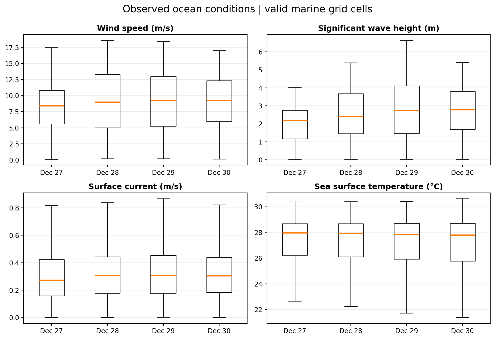
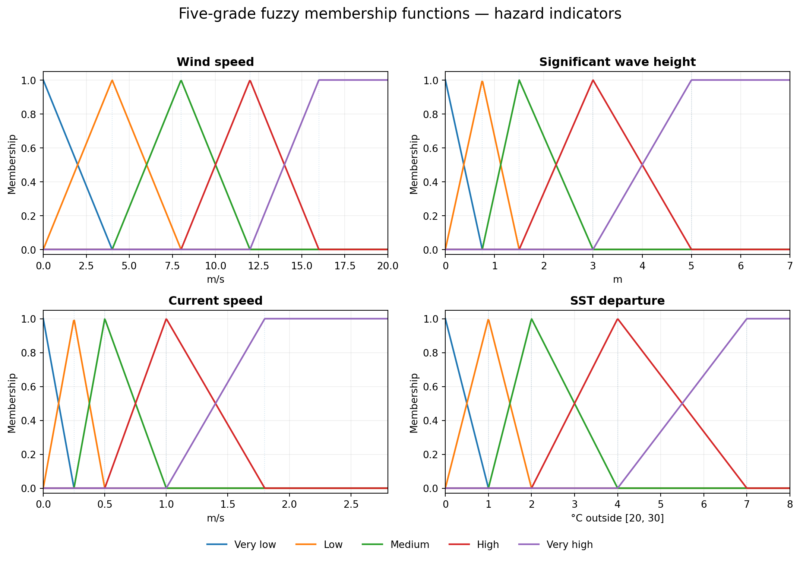
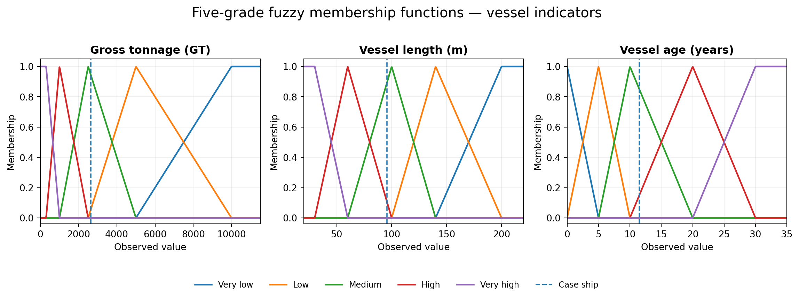
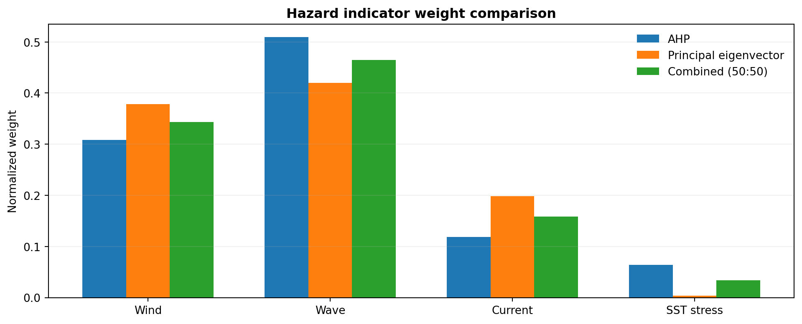
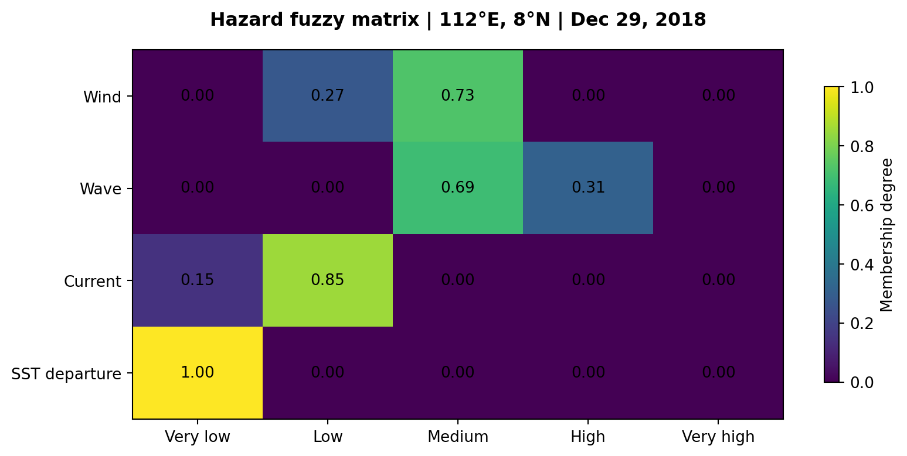
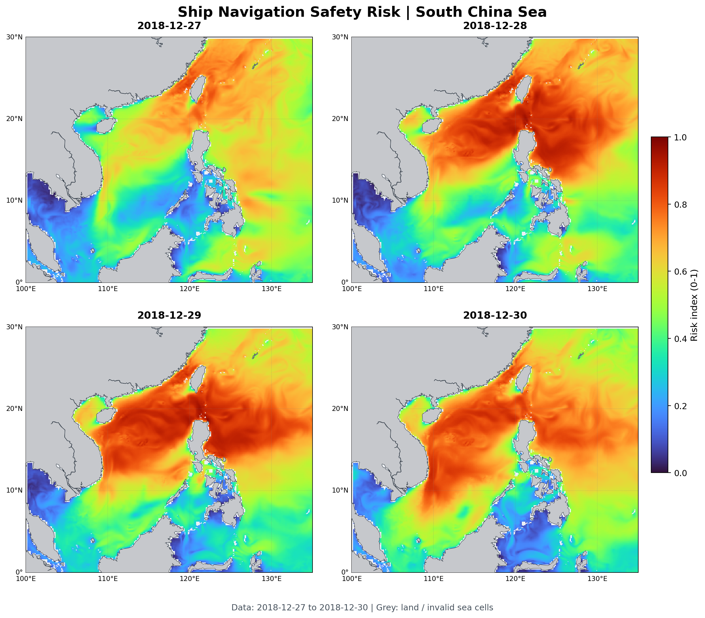
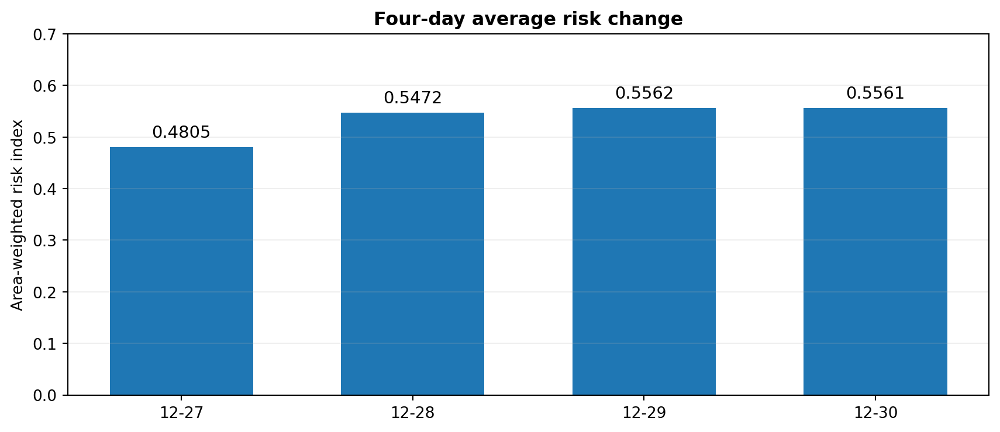
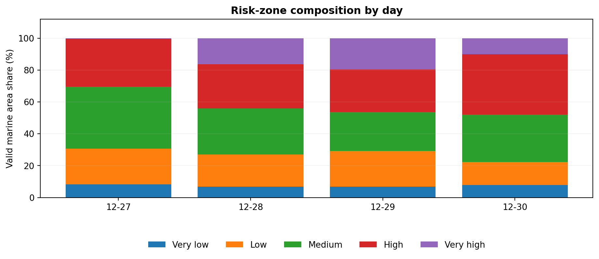
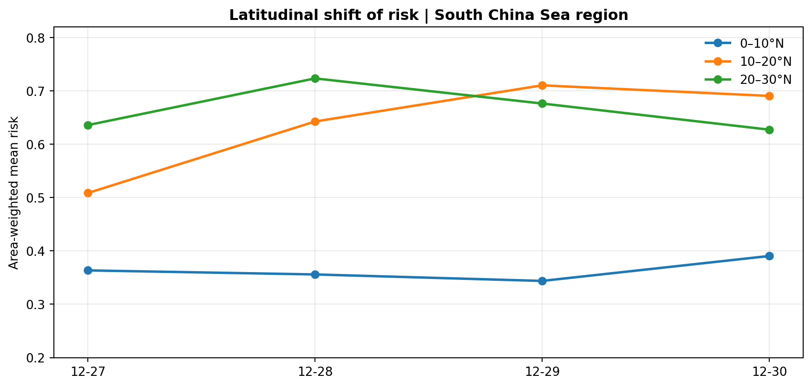
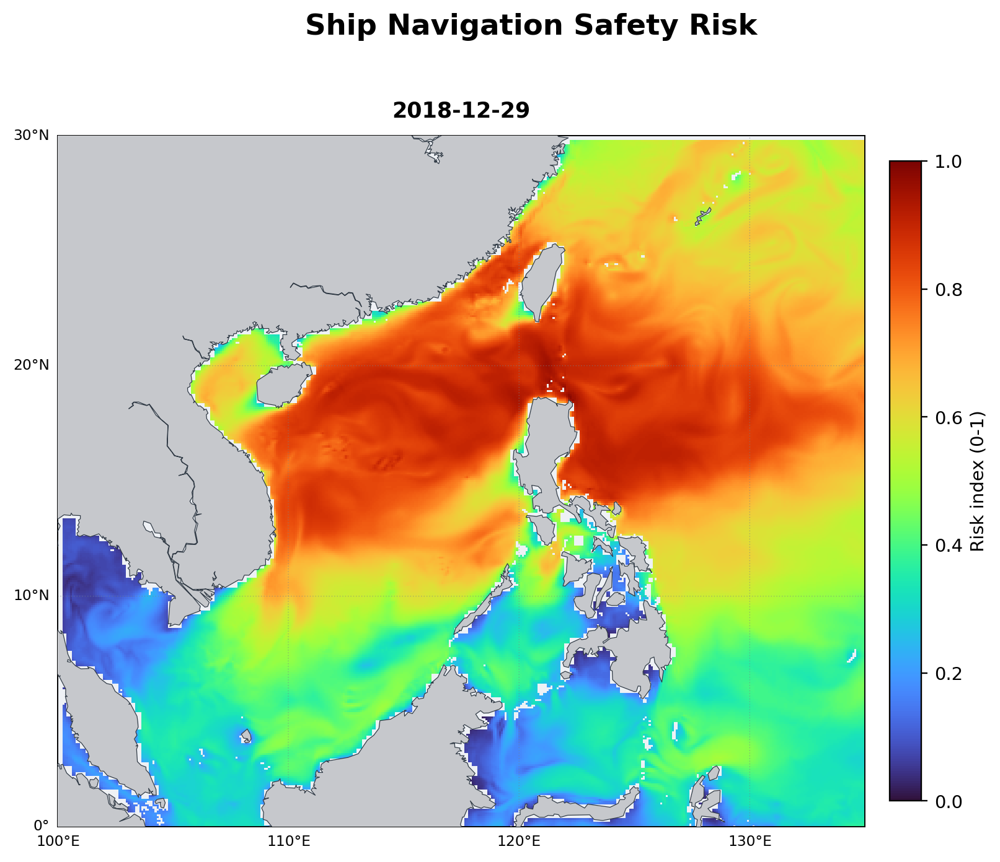
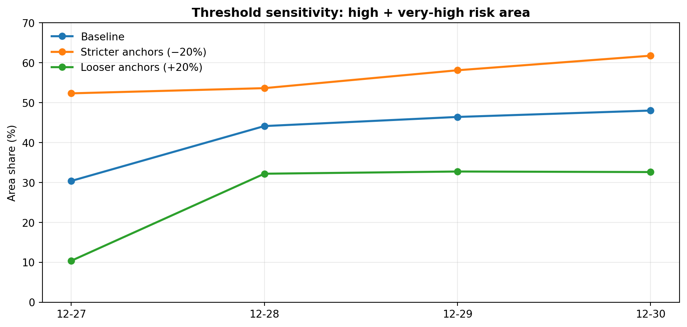
